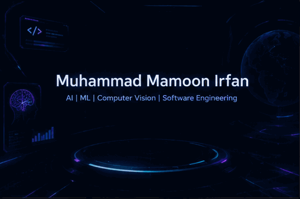

# Muhammad Mamoon Irfan

**Aspiring AI/ML Engineer | Computer Science Student | Software Developer**

I am a Computer Science student at the **University of Management and Technology (UMT), Lahore, Pakistan**, with an expected graduation in **2027**. My interests lie in **Artificial Intelligence, Machine Learning, Computer Vision, and building practical software products**.

---

## 👨‍💻 About Me

- 🎓 **BS Computer Science** — University of Management and Technology (UMT), 2023–2027.
- 📊 **CGPA:** 3.78/4.00 through the 6th semester, as listed on my LinkedIn profile.
- 🤖 Aspiring **AI/ML Engineer**, particularly interested in Machine Learning and Computer Vision.
- 🧪 Exploring model development, data analysis, feature engineering, and practical AI applications.
- 🛠️ Building software with Python, C++, APIs, and modern development tools.
- 🤝 Interested in collaborative projects, continuous learning, and solving real-world problems.

## 💼 Experience & Professional Learning

| Organization | Experience |
|---|---|
| **NETSOL Technologies Pakistan** | AI/ML Trainee — NIAI / NAVTTC Cohort II |
| **Beyond East** | Data Analytics Intern |
| **Abstron \| XR \| Games** | Software Quality Assurance experience |

## 🏆 Achievements

- **Dean’s Merit Award** — 3.95/4.00 semester GPA, University of Management and Technology.
- **Rector’s Merit Award** — 4.00/4.00 semester GPA, University of Management and Technology.
- **Peer Tutor** — Supported Computer Networks students at UMT; recognized with the Peer Tutor Special Appreciation Award 2025–26.

## 🧰 Technical Skills

### Programming & Databases

### AI, Machine Learning & Data Science

### Backend, Web & Developer Tools

---

## 🚀 Featured Projects

### 1. DERIVA Compiler Studio

An interactive, browser-based environment for exploring automata theory and compiler construction. It provides automata construction and minimization workflows alongside a multi-stage compiler for the custom Deriva language.

**Technologies:** React · TypeScript · Vite · Tailwind CSS

### 2. Fabric Defect Detection Using Machine Learning

A machine-learning project focused on automated textile quality inspection using computer vision and feature engineering for multi-class fabric defect detection.

**Focus:** Computer Vision · Feature Engineering · Classical Machine Learning

### 3. 3D Human Anatomy Explorer

An interactive 3D anatomy exploration project.

### 4. Signature Detection & Similarity System

A collaborative project exploring signature-region detection and signature comparison. Its documentation outlines a target architecture using React, FastAPI, asynchronous processing, and machine-learning components. The repository README distinguishes planned workflows from verified implementation.

### 5. Hotel Management System — Data Structures & Algorithms

A C++ hotel management project demonstrating the practical use of linked lists, queues, priority queues, and stacks for room management and booking workflows.

**Technologies:** C++ · OOP · Linked Lists · Queues · Priority Queues · Stacks

### 6. C++ & Python Data Science Notes

A learning repository for programming and data-science concepts.

---

## 📊 GitHub Analytics

### GitHub Statistics

### Most Used Languages

### Contribution Streak

### Contribution Activity

---

## 🤝 Let's Connect

I am interested in connecting with developers, learning from the community, and collaborating on meaningful projects in AI, Machine Learning, Computer Vision, and software development.

---

**Thanks for visiting my profile! Feel free to explore my repositories and connect with me.**
